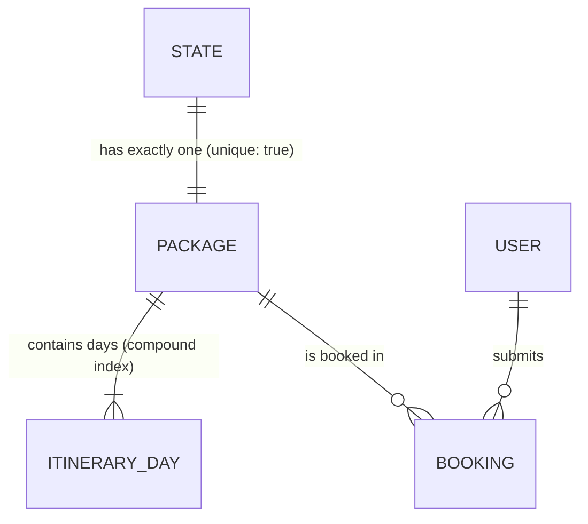

# Bharat Darshan — Discover India. Experience Every Journey.

> A full-stack MERN platform celebrating India's 28 States and 8 Union Territories with curated single-package itineraries, zero-trust backend price validation, and editorial travel-tech design.

---

## 🌟 Project Overview

**Bharat Darshan** (*"A Tour of India"*) is an editorial-style tourism and journey discovery platform. Designed with the aesthetics of a modern travel publication, it presents **all 36 regions of India** (28 States + 8 Union Territories) with a thoughtful, geographically realistic master tour package for each region.

### 🏛️ Core Architectural Rules
1. **The "Exactly One Package" Rule:** Every State and Union Territory has exactly one comprehensive tour package curated around its geography, travel distances, and cultural heritage. Enforced at both the Mongoose schema level (`unique: true`) and controller validation.
2. **Zero-Trust Backend Pricing:** The frontend displays real-time price calculations as a courtesy to the traveller ($Total = Price \times Travellers$), but the backend alone recalculates, authenticates, and locks price snapshots upon enquiry submission.
3. **Enquiry-First Workflow:** Enquiries are submitted with a `Pending` status. Destination specialists review logistics and update statuses (`Pending` $\rightarrow$ `Confirmed` $\rightarrow$ `Completed`) via the Admin Console.
4. **Authenticity & Integrity:** No fake reviews, synthetic visitor counters, or artificial discount timers. Real geographic coordinates powered by OpenStreetMap & Leaflet.

---

## 🛠️ Technology Stack

| Layer | Technologies |
|---|---|
| **Frontend** | React.js (Vite), Tailwind CSS, React Router DOM (v6), Axios, Framer Motion, Lucide Icons, Leaflet & React-Leaflet |
| **Backend** | Node.js, Express.js, REST APIs |
| **Database** | MongoDB (Local / Atlas), Mongoose ODM |
| **Authentication** | JWT (JSON Web Tokens), bcryptjs password hashing |
| **Design System** | Deep Forest Green (`#142B25`), Warm Gold (`#D5A45D`), Warm Ivory (`#F5F0E7`), Charcoal (`#252A32`) |

---

## 📁 Project Architecture

```text
BharatDarshan/
├── frontend/                     # React + Vite Client
│   ├── src/
│   │   ├── components/
│   │   │   ├── common/           # Button, Modal, Badge
│   │   │   ├── layout/           # Navbar, Footer, MainLayout
│   │   │   ├── home/             # HeroSection, EditorialIntro, ExploreGrid, CategoriesSection
│   │   │   └── region/           # RegionHero, LeafletMap, ItineraryTimeline, PriceCalculator, EnquiryModal
│   │   ├── data/                 # 36-Region Data Registry & Rajasthan Master Dataset
│   │   ├── pages/                # HomePage, ExplorePage, RegionDetailPage, UserDashboard, AdminDashboard, LoginPage, RegisterPage
│   │   ├── services/             # Axios API Client with JWT Interceptors (api.js)
│   │   ├── App.jsx               # Client Routing
│   │   └── index.css             # Tailwind Directives & Custom Design System
│   └── package.json
├── backend/                      # Node.js + Express API
│   ├── src/
│   │   ├── config/               # MongoDB Connection (db.js)
│   │   ├── controllers/          # authController, stateController, packageController, bookingController, adminController
│   │   ├── middleware/           # authMiddleware (JWT verify), errorMiddleware
│   │   ├── models/               # User, State, Package, ItineraryDay, Booking
│   │   ├── routes/               # authRoutes, stateRoutes, packageRoutes, bookingRoutes, adminRoutes
│   │   ├── utils/                # seedData.js, generateToken.js
│   │   ├── app.js                # Express App Configuration
│   │   └── server.js             # HTTP Server Entry Point
│   ├── .env.example
│   └── package.json
└── README.md
```

---

## 🗄️ Database Schema & Uniqueness



* **One Package Enforcement:** In `models/Package.js`:
  ```javascript
  stateId: {
    type: mongoose.Schema.Types.ObjectId,
    ref: 'State',
    required: true,
    unique: true // Database-level unique index ensures exactly 1 package per region
  }
  ```
* **Compound Day Index:** In `models/ItineraryDay.js`:
  ```javascript
  ItineraryDaySchema.index({ packageId: 1, dayNumber: 1 }, { unique: true });
  ```

---

## 📡 REST API Endpoints

| Method | Endpoint | Access | Purpose |
|---|---|---|---|
| `GET` | `/api/health` | Public | System status and database health check |
| `POST` | `/api/auth/register` | Public | Register new traveller with hashed password |
| `POST` | `/api/auth/login` | Public | Authenticate user credentials and return JWT |
| `GET` | `/api/auth/me` | Protected | Get current authenticated user profile |
| `GET` | `/api/states` | Public | Fetch all 36 regions with filters (`?search=`, `?type=`, `?category=`) |
| `GET` | `/api/states/:slug` | Public | Fetch region details, single package, and 9-day itinerary |
| `GET` | `/api/packages` | Public | Fetch all active packages with pricing |
| `POST` | `/api/bookings` | Public / User | Zero-trust backend calculated booking enquiry submission |
| `GET` | `/api/bookings/my-trips` | Protected (User) | View authenticated user's submitted enquiries |
| `GET` | `/api/admin/dashboard` | Protected (Admin) | Retrieve operations statistics and metrics |
| `GET` | `/api/admin/bookings` | Protected (Admin) | View all customer enquiries across all regions |
| `PATCH` | `/api/admin/bookings/:id/status` | Protected (Admin) | Update enquiry status (`Pending` $\rightarrow$ `Confirmed` / `Cancelled`) |

---

## 🚀 Getting Started

### 1. Prerequisites
- Node.js (v18+ recommended)
- MongoDB running locally or a MongoDB Atlas URI

### 2. Backend Setup
```bash
cd backend
npm install

# Seed the database with all 36 States, UTs, Packages, and Users
npm run seed

# Start the backend server (runs on port 5000)
npm run dev
```

### 3. Frontend Setup
```bash
cd frontend
npm install

# Start the Vite client (runs on port 5173)
npm run dev
```

### 4. Demo Login Credentials
- **Standard Traveller Account:**
  - Email: `aarav@example.com`
  - Password: `Travel@123`
  - Role: `user`
- **Administrator Account:**
  - Email: `admin@bharatdarshan.com`
  - Password: `Admin@123`
  - Role: `admin`

---

## 🎨 Design Philosophy & Features

- **Flagship Rajasthan Reference:** Interactive Leaflet route map with verified coordinates, 9-day editorial itinerary timeline, and live Price Calculator.
- **Dynamic Pricing Snapshot:** The backend calculates $Total = ₹34,500 \times Pax$ and preserves this historical snapshot against future package price changes.
- **Responsive Navigation:** Floating glassmorphic header, editorial typography with inline image badges, and mobile drawer.
