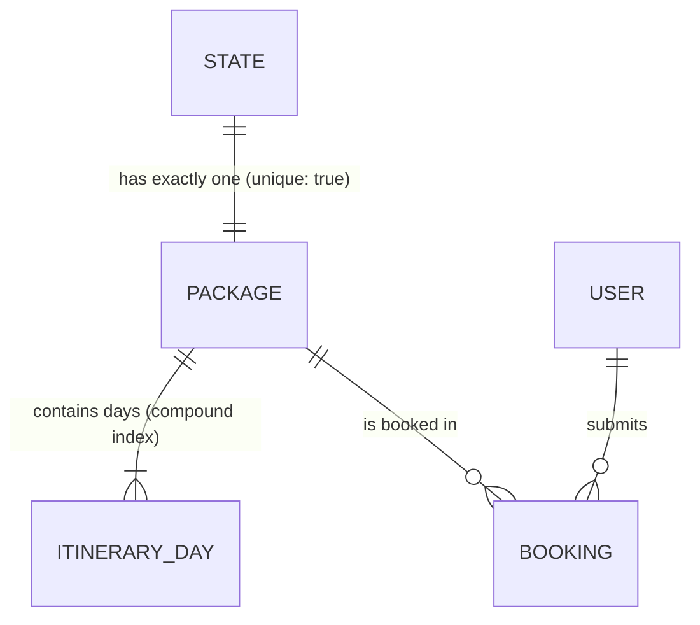

# Bharat Darshan — Discover India. Experience Every Journey.

> A production-ready, full-stack travel platform celebrating India's 28 States and 8 Union Territories with curated master itineraries, an interactive 3D WebGL India map, zero-trust backend price validation, and editorial design.

---

## 🌟 Project Overview

**Bharat Darshan** (*"A Tour of India"*) is a luxury travel-tech publication and journey discovery platform. Engineered with modern full-stack best practices, it presents all **36 regions of India** (28 States + 8 Union Territories) with authentic imagery, detailed cultural guides, live price calculators, and realistic day-by-day travel itineraries.

### 🏛️ Core Architectural Guarantees
1. **The "Exactly One Package" Rule:** Every State and Union Territory has exactly one comprehensive tour package curated around its geography, travel distances, and cultural heritage. Enforced at both the Mongoose schema level (`unique: true`) and controller validation.
2. **Zero-Trust Backend Pricing:** The frontend displays real-time price calculations as a courtesy to the traveler ($Total = Price \times Travelers$), but the backend alone recalculates, authenticates, and locks price snapshots upon enquiry submission.
3. **Interactive 3D WebGL India Map:** Custom Three.js map with accurate state coordinates, unbroken national outer boundary strokes, interactive state focus dots, and 2D smooth panning.
4. **Cloud-Native Database:** Seamlessly integrated with MongoDB Atlas with production connection pooling and resilient DNS SRV resolution.
5. **Production Security:** HTTP Security Headers with Helmet, tiered rate-limiting against DDoS/brute-force attacks, CORS origin whitelisting, and credential encryption via bcryptjs and JWT.

---

## 🛠️ Technology Stack

| Layer | Technologies |
|---|---|
| **Frontend** | React 19, Vite, Tailwind CSS, Framer Motion, Three.js, Lucide Icons, Leaflet / React-Leaflet, Axios |
| **Backend** | Node.js (ES Modules), Express.js, Helmet, Express-Rate-Limit, CORS, Dotenv |
| **Database** | MongoDB Atlas (Cloud), Mongoose ODM 9.x |
| **Authentication** | JWT (JSON Web Tokens), bcryptjs password hashing |
| **Deployment** | Vercel (Frontend SPA) + Render / Railway (Backend API) + MongoDB Atlas |

---

## 📁 Project Architecture

```text
BharatDarshan/
├── frontend/                     # React + Vite Client
│   ├── public/                   # Static assets & images
│   ├── src/
│   │   ├── assets/               # Brand logos and vector graphics
│   │   ├── components/
│   │   │   ├── common/           # Shared UI elements
│   │   │   ├── home/             # Hero, 3D Map, Journeys, Culture, Plan Your Journey
│   │   │   ├── layout/           # Navbar, Footer, MainLayout
│   │   │   └── region/           # RegionHero, LeafletMap, Itinerary, PriceCalculator, EnquiryModal
│   │   ├── data/                 # 36-Region Datasets, GeoJSON, Attractions
│   │   ├── pages/                # HomePage, ExplorePage, RegionDetailPage, Dashboards, Auth
│   │   ├── services/             # Axios API Client with JWT Interceptors (api.js)
│   │   ├── App.jsx               # Client Routing with React.lazy code splitting
│   │   └── index.css             # Tailwind Directives & Custom Design System
│   ├── .env.example              # Frontend environment template
│   ├── vercel.json               # Vercel SPA routing redirects
│   ├── vite.config.js            # Rolldown / Vite production bundle optimization
│   └── package.json
├── backend/                      # Node.js + Express API
│   ├── src/
│   │   ├── config/               # MongoDB Atlas Connection with DNS SRV fallback (db.js)
│   │   ├── controllers/          # authController, stateController, packageController, bookingController, adminController
│   │   ├── middleware/           # authMiddleware (JWT protect & role authorize)
│   │   ├── models/               # User, State, Package, ItineraryDay, Booking
│   │   ├── routes/               # authRoutes, stateRoutes, packageRoutes, bookingRoutes, adminRoutes
│   │   ├── utils/                # seedData.js, generateToken.js
│   │   ├── app.js                # Express App with Helmet, Rate Limiter & CORS
│   │   └── server.js             # HTTP Server with Graceful Shutdown handlers
│   ├── .env.example              # Backend environment template
│   └── package.json
├── .gitignore                    # Global repository security exclusions
└── README.md
```

---

## 🗄️ Database Architecture & Schemas



* **One Package Constraint:** In `backend/src/models/Package.js`:
  ```javascript
  stateId: {
    type: mongoose.Schema.Types.ObjectId,
    ref: 'State',
    required: true,
    unique: true // Database-level unique index ensures exactly 1 package per region
  }
  ```
* **Compound Day Index:** In `backend/src/models/ItineraryDay.js`:
  ```javascript
  ItineraryDaySchema.index({ packageId: 1, dayNumber: 1 }, { unique: true });
  ```

---

## 📡 REST API Reference

| Method | Endpoint | Access | Purpose |
|---|---|---|---|
| `GET` | `/api/health` | Public | System status, database connection, and uptime check |
| `POST` | `/api/auth/register` | Public | Register new traveller with hashed password |
| `POST` | `/api/auth/login` | Public | Authenticate user credentials and return JWT |
| `GET` | `/api/auth/me` | Protected | Get current authenticated user profile |
| `GET` | `/api/states` | Public | Fetch all 36 regions with filters (`?search=`, `?type=`, `?category=`) |
| `GET` | `/api/states/:slug` | Public | Fetch region details, single package, and 9-day itinerary |
| `GET` | `/api/packages` | Public | Fetch all active packages with pricing |
| `POST` | `/api/bookings` | Public / User | Zero-trust backend calculated booking enquiry submission |
| `GET` | `/api/bookings/my-trips` | Protected (User) | View authenticated user's submitted enquiries |
| `GET` | `/api/admin/dashboard` | Protected (Admin) | Retrieve operations statistics and metrics |
| `GET` | `/api/admin/bookings` | Protected (Admin) | View all customer enquiries across all regions |
| `PATCH` | `/api/admin/bookings/:id/status` | Protected (Admin) | Update enquiry status (`Pending` $\rightarrow$ `Confirmed` / `Cancelled`) |

---

## 🚀 Local Development Setup

### 1. Prerequisites
- Node.js (v18.0.0 or higher)
- npm (v9.0.0 or higher)
- A free MongoDB Atlas cluster or local MongoDB instance

### 2. Backend Setup
```bash
# Navigate to backend directory
cd backend

# Install production dependencies
npm install

# Create your .env file from the template
cp .env.example .env
# Open .env and add your MONGODB_URI and JWT_SECRET

# (Optional) Seed the database with all 36 States, Packages, and Demo Accounts
node src/utils/seedData.js

# Start the dev server with hot reload
npm run dev
```
The backend server runs on `http://localhost:5000`.

### 3. Frontend Setup
```bash
# Navigate to frontend directory
cd frontend

# Install dependencies
npm install

# Create your .env file
cp .env.example .env

# Start Vite client
npm run dev
```
The frontend client runs on `http://localhost:5173`.

---

## 🔐 Demo Credentials

| Role | Email | Password | Access Level |
|---|---|---|---|
| **Administrator** | `admin@bharatdarshan.com` | `Admin@123` | Full access to Admin Console, KPI stats & enquiry status updates |
| **Traveller** | `aarav@example.com` | `Travel@123` | Booking history, personalised profile dashboard & enquiries |

---

## 🚢 Production Deployment Guide

### Option 1: Vercel (Frontend) + Render / Railway (Backend) [Recommended]

#### 1. Deploy Backend on Render
1. Sign in to [Render](https://render.com) and click **"New Web Service"**.
2. Connect your GitHub repository.
3. Configure the service:
   * **Root Directory:** `backend`
   * **Environment:** `Node`
   * **Build Command:** `npm install`
   * **Start Command:** `npm start`
4. Under **Environment Variables**, add:
   * `NODE_ENV`: `production`
   * `PORT`: `5000` (or leave default assigned by Render)
   * `CLIENT_URL`: `https://your-frontend.vercel.app` (your Vercel app domain)
   * `MONGODB_URI`: Your MongoDB Atlas connection string
   * `JWT_SECRET`: A secure random secret string
   * `JWT_EXPIRES_IN`: `7d`
5. Click **Create Web Service**. Note your public backend URL (e.g. `https://bharatdarshan-api.onrender.com`).

#### 2. Deploy Frontend on Vercel
1. Sign in to [Vercel](https://vercel.com) and click **"Add New Project"**.
2. Import your GitHub repository.
3. Configure project settings:
   * **Framework Preset:** `Vite`
   * **Root Directory:** `frontend` (or keep root; root `vercel.json` is preconfigured)
   * **Build Command:** `npm run build`
   * **Output Directory:** `dist`
4. Under **Environment Variables**, add:
   * `VITE_API_URL`: `https://bharatdarshan-api.onrender.com/api` (your Render backend URL + `/api`)
5. Click **Deploy**. Vercel will automatically build the site with client-side SPA routing preconfigured via `vercel.json`.

---

### Option 2: One-Click Render Blueprint (`render.yaml`)
This repository includes a preconfigured `render.yaml` Blueprint file:
1. Connect your repository to Render.
2. Select **"Blueprints"** from the Render dashboard.
3. Render automatically provisions both the **`bharatdarshan-api`** (Node Web Service) and **`bharatdarshan-ui`** (Static Site), cross-linking environment variables (`VITE_API_URL` and `CLIENT_URL`) automatically!
4. Simply input your `MONGODB_URI` when prompted and click **Apply**.

---

### Option 3: Netlify (Frontend)
1. Connect your GitHub repository to [Netlify](https://netlify.com).
2. The included `netlify.toml` automatically configures `base = "frontend"`, `publish = "dist"`, and SPA rewrites (`/* -> /index.html`).
3. Add environment variable `VITE_API_URL` pointing to your deployed backend API.

---

### Option 4: Unified Monorepo (Single Server)
If you deploy to a single VPS, Railway, or Docker container:
1. Run `npm run install:all` to install all dependencies.
2. Run `npm run build` to compile the React frontend into `frontend/dist`.
3. Set `NODE_ENV=production` and run `npm start`.
4. The Express server automatically serves the frontend static SPA from `frontend/dist` and handles `/api/*` endpoints on the exact same port!

---

## 🛡️ Security Best Practices Implemented
* **No Leaked Secrets:** All sensitive credentials (`.env`) are strictly excluded in `.gitignore`.
* **Zero Client Price Tampering:** Booking totals are computed authoritatively on the server.
* **Rate-Limiting:** IP-based throttling protects against API abuse and login brute-forcing.
* **Helmet Protection:** Production HTTP headers enforce HSTS, frame protection, and content security.
* **Graceful Shutdown:** Handles `SIGINT` and `SIGTERM` signals, safely releasing database connections and flushing pending requests.
